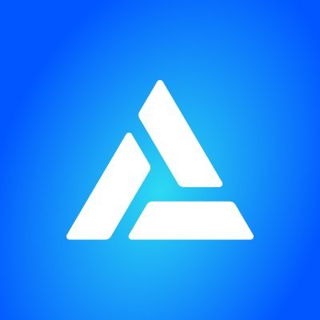
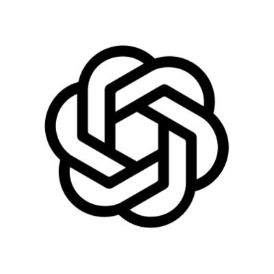
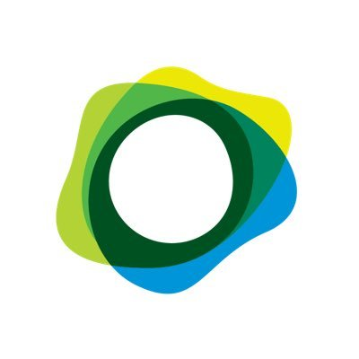
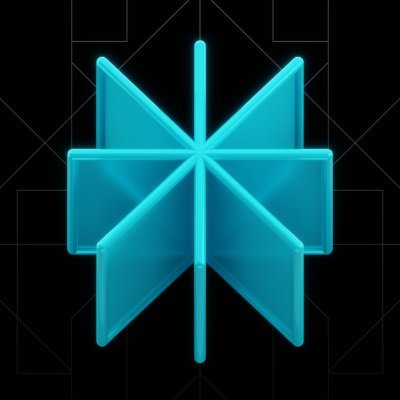
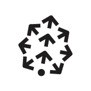
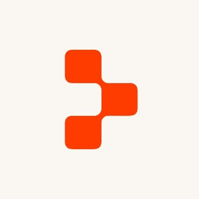
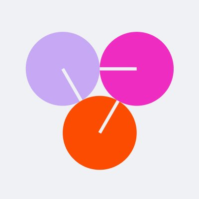
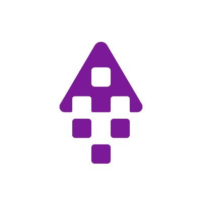
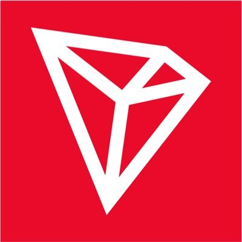
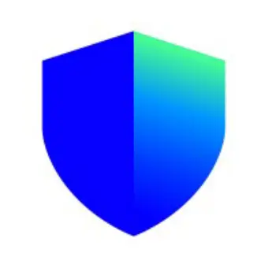

# 🔥 Daily Remote Jobs

  

  <strong><a href="https://www.remotejobscan.com">RemoteJobScan.com</a></strong> &nbsp;·&nbsp; <a href="README.md">📖 中文</a>

  <strong>Real-time remote jobs in AI, Web3, blockchain &amp; crypto.</strong> 
  <strong>Every listing sourced directly from official company websites.</strong>

  📊 <strong>50</strong> companies · <strong>3232</strong> remote jobs · Updated every 30 min

---

## 🆕 Latest Updates（20 featured jobs）

| Position | Location | Details |
|---|---|---|
| Sales Engineering Manager, Northern Europe & DACH | On-site | [View →](https://www.remotejobscan.com/job/19641/sales-engineering-manager-northern-europe-dach/) |
| Business Value Strategist | On-site | [View →](https://www.remotejobscan.com/job/19695/business-value-strategist/) |
| Partnerships Lead, Southern Europe | Hybrid | [View →](https://www.remotejobscan.com/job/19569/partnerships-lead-southern-europe/) |
| DevRel Engineer, Agentic Infrastructure | Hybrid | [View →](https://www.remotejobscan.com/job/11473/devrel-engineer-agentic-infrastructure/) |
| Software Engineer, Agentic Infrastructure | Hybrid | [View →](https://www.remotejobscan.com/job/19485/software-engineer-agentic-infrastructure/) |
| Business Operations Associate | Remote | [View →](https://www.remotejobscan.com/job/19694/business-operations-associate/) |
| Solutions Architect (Inference) | On-site | [View →](https://www.remotejobscan.com/job/19692/solutions-architect-inference/) |
| Engineering Manager – Growth Product | Remote | [View →](https://www.remotejobscan.com/job/19693/engineering-manager-growth-product/) |
| Google Cloud GTM Partnerships Lead, EMEA | On-site | [View →](https://www.remotejobscan.com/job/19691/google-cloud-gtm-partnerships-lead-emea/) |
| Sales Operations Analyst - Payward Services | Remote | [View →](https://www.remotejobscan.com/job/19379/sales-operations-analyst-payward-services/) |
| 统一账户测试工程师 Unified Account Test Engineer | Remote | [View →](https://www.remotejobscan.com/job/19690/unified-account-test-engineer/) |
| Senior HR Admin Specialist (Austria) | Remote | [View →](https://www.remotejobscan.com/job/19689/senior-hr-admin-specialist-austria/) |
| Java Technology Expert (Unified Account) Java 技术专家（统一账户） | Remote | [View →](https://www.remotejobscan.com/job/15766/java-technology-expert-unified-account-java/) |
| International Infrastructure Accounting | On-site | [View →](https://www.remotejobscan.com/job/19687/international-infrastructure-accounting/) |
| Manager, Applied AI Architects (Australia) | On-site | [View →](https://www.remotejobscan.com/job/19688/manager-applied-ai-architects-australia/) |
| Security Operations Specialist (Soc) 安全运营专家（soc） | Remote | [View →](https://www.remotejobscan.com/job/19252/security-operations-specialist-soc-soc/) |
| AI Platform Product Lead AI中台产品负责人 | Remote | [View →](https://www.remotejobscan.com/job/19165/ai-platform-product-lead-ai/) |
| flutter工程师（合规方向）Flutter Engineer (Compliance Focus) | Remote | [View →](https://www.remotejobscan.com/job/19686/flutterflutter-engineer-compliance-focus/) |
| IOS开发工程师（合规方向）iOS Development Engineer (Compliance Focus) | Remote | [View →](https://www.remotejobscan.com/job/19683/iosios-development-engineer-compliance-focus/) |
| 安卓开发(合规方向) Android Development (Compliance Focus) | Remote | [View →](https://www.remotejobscan.com/job/19684/android-development-compliance-focus/) |
[📋 Browse all jobs →](https://www.remotejobscan.com)

---

## 🏢 Companies Tracked（50 companies）

| Company | Website | Jobs |
|---|---|---|
|  | <a href="https://1inch.com/">1inch</a> | [View jobs →](https://www.remotejobscan.com/?company=1inch) |
|  | <a href="https://aave.com/">Aave</a> | [View jobs →](https://www.remotejobscan.com/?company=aave) |
|  | <a href="https://www.alchemy.com/">Alchemy</a> | [View jobs →](https://www.remotejobscan.com/?company=alchemy) |
|  | <a href="https://www.anthropic.com/">Anthropic</a> | [View jobs →](https://www.remotejobscan.com/?company=anthropic) |
|  | <a href="https://aptoslabs.com/">Aptos Labs</a> | [View jobs →](https://www.remotejobscan.com/?company=aptos-labs) |
|  | <a href="https://asterdex.com">Aster</a> | [View jobs →](https://www.remotejobscan.com/?company=aster) |
|  | <a href="https://www.binance.com">Binance</a> | [View jobs →](https://www.remotejobscan.com/?company=binance) |
|  | <a href="https://www.bitget.com/">Bitget</a> | [View jobs →](https://www.remotejobscan.com/?company=bitget) |
|  | <a href="https://www.bnbchain.org">BNB Chain</a> | [View jobs →](https://www.remotejobscan.com/?company=bnb-chain) |
|  | <a href="https://bybitglobal.com/">Bybit</a> | [View jobs →](https://www.remotejobscan.com/?company=bybit) |
|  | <a href="https://www.certik.com/">CertiK</a> | [View jobs →](https://www.remotejobscan.com/?company=certik) |
|  | <a href="https://www.circle.com/">Circle</a> | [View jobs →](https://www.remotejobscan.com/?company=circle) |
|  | <a href="https://cohere.com/">Cohere</a> | [View jobs →](https://www.remotejobscan.com/?company=cohere) |
|  | <a href="https://www.coinbase.com/">Coinbase</a> | [View jobs →](https://www.remotejobscan.com/?company=coinbase) |
|  | <a href="https://www.coinex.com">CoinEx</a> | [View jobs →](https://www.remotejobscan.com/?company=coinex) |
|  | <a href="https://coinmarketcap.com">CoinMarketCap</a> | [View jobs →](https://www.remotejobscan.com/?company=coinmarketcap) |
|  | <a href="https://www.coins.ph">coins.ph</a> | [View jobs →](https://www.remotejobscan.com/?company=coins-ph) |
|  | <a href="https://crypto.com/">crypto.com</a> | [View jobs →](https://www.remotejobscan.com/?company=crypto-com) |
|  | <a href="https://www.digifinex.com">DigiFinex</a> | [View jobs →](https://www.remotejobscan.com/?company=digifinex) |
|  | <a href="https://elevenlabs.io/">ElevenLabs</a> | [View jobs →](https://www.remotejobscan.com/?company=elevenlabs) |
|  | <a href="https://www.gate.com/">Gate</a> | [View jobs →](https://www.remotejobscan.com/?company=gate) |
|  | <a href="https://www.gauntlet.xyz/">Gauntlet</a> | [View jobs →](https://www.remotejobscan.com/?company=gauntlet) |
|  | <a href="https://www.gemini.com/">Gemini</a> | [View jobs →](https://www.remotejobscan.com/?company=gemini) |
|  | <a href="https://www.hashoptima.com">HashOptima</a> | [View jobs →](https://www.remotejobscan.com/?company=hashoptima) |
|  | <a href="https://hyperfoundation.org/">Hyperliquid</a> | [View jobs →](https://www.remotejobscan.com/?company=hyperliquid) |
|  | <a href="https://www.kraken.com/">Kraken</a> | [View jobs →](https://www.remotejobscan.com/?company=kraken) |
|  | <a href="https://www.kucoin.com/">KuCoin</a> | [View jobs →](https://www.remotejobscan.com/?company=kucoin) |
|  | <a href="https://www.langchain.com/">LangChain</a> | [View jobs →](https://www.remotejobscan.com/?company=langchain) |
|  | <a href="https://layerzero.network">LayerZero</a> | [View jobs →](https://www.remotejobscan.com/?company=layerzero) |
|  | <a href="https://www.lbank.com/">Lbank</a> | [View jobs →](https://www.remotejobscan.com/?company=lbank) |
|  | <a href="https://lista.org">Lista DAO</a> | [View jobs →](https://www.remotejobscan.com/?company=lista-dao) |
|  | <a href="https://nodereal.io">NodeReal</a> | [View jobs →](https://www.remotejobscan.com/?company=nodereal) |
|  | <a href="https://www.offchainlabs.com/">OffchainLabs</a> | [View jobs →](https://www.remotejobscan.com/?company=offchainlabs) |
|  | <a href="http://okx.com/">OKX</a> | [View jobs →](https://www.remotejobscan.com/?company=okx) |
|  | <a href="https://www.optimism.io/">OP Labs</a> | [View jobs →](https://www.remotejobscan.com/?company=op-labs) |
|  | <a href="https://openai.com/">OpenAI</a> | [View jobs →](https://www.remotejobscan.com/?company=openai) |
|  | <a href="https://www.paxos.com">PAXOS</a> | [View jobs →](https://www.remotejobscan.com/?company=paxos) |
|  | <a href="https://www.perplexity.ai/">Perplexity</a> | [View jobs →](https://www.remotejobscan.com/?company=perplexity) |
|  | <a href="https://phantom.com/">Phantom</a> | [View jobs →](https://www.remotejobscan.com/?company=phantom) |
|  | <a href="https://www.pinecone.io/">Pinecone</a> | [View jobs →](https://www.remotejobscan.com/?company=pinecone) |
|  | <a href="https://predict.fun">Predict</a> | [View jobs →](https://www.remotejobscan.com/?company=predict) |
|  | <a href="https://replit.com/">Replit</a> | [View jobs →](https://www.remotejobscan.com/?company=replit) |
|  | <a href="https://solana.org/">Solana Foundation</a> | [View jobs →](https://www.remotejobscan.com/?company=solana-foundation) |
|  | <a href="https://www.sui.io">Sui</a> | [View jobs →](https://www.remotejobscan.com/?company=sui) |
|  | <a href="https://www.together.ai/">Together AI</a> | [View jobs →](https://www.remotejobscan.com/?company=together-ai) |
|  | <a href="https://tothemoon.com/">Tothemoon</a> | [View jobs →](https://www.remotejobscan.com/?company=tothemoon) |
|  | <a href="https://tron.network">TRON</a> | [View jobs →](https://www.remotejobscan.com/?company=tron) |
|  | <a href="https://trustwallet.com">Trust Wallet</a> | [View jobs →](https://www.remotejobscan.com/?company=trust-wallet) |
|  | <a href="https://u.tech">United Stables</a> | [View jobs →](https://www.remotejobscan.com/?company=united-stables) |
|  | <a href="https://vercel.com/">Vercel</a> | [View jobs →](https://www.remotejobscan.com/?company=vercel) |

---

---

  Maintained by <a href="https://www.remotejobscan.com">RemoteJobScan</a> · 2026-11-11 19:00 UTC 
  ⭐ Star this repo if you find it useful

